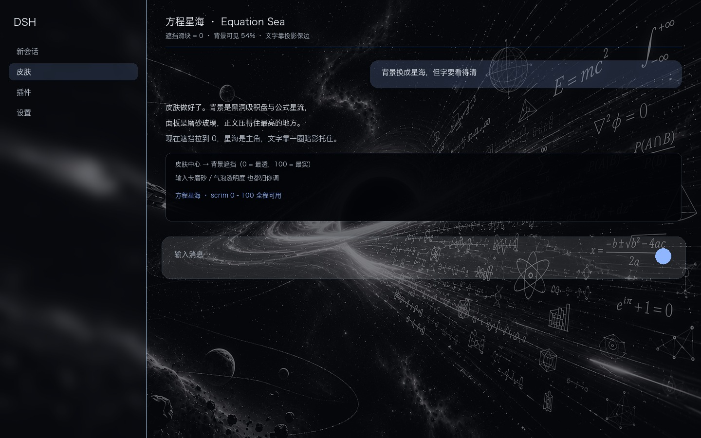
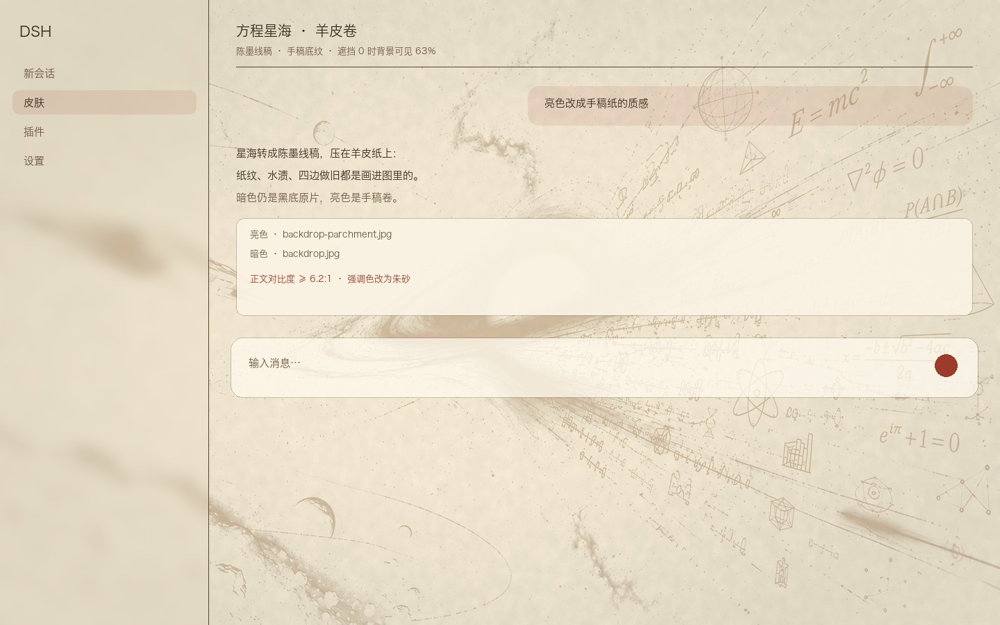

# 方程星海 · Equation Sea

> 一个透明 DSH Web GUI 皮肤：**黑洞吸积盘当背景，公式星流浮在星海里。**
> 目标不是把界面调暗，而是用「玻璃厚度」换可读性——背景看得见，字也看得清。




---

## 它长什么样

- **暗色**：原片。黑底星海、吸积盘、漂浮的欧拉公式与莫比乌斯环，面板是黑玻璃，星海透出约 38%
- **亮色**：羊皮卷。同一张图转成陈墨线稿，压在做旧纸面上，面板变白雾玻璃
- **可调**：皮肤中心的「背景遮挡」滑块 0–100% 连续生效，透到最透也不会糊字

## 设计

| 决定 | 做法 |
|---|---|
| 背景 | 原图 16:9 补边到 2560×1440，提亮暗部（原画 79% 是纯黑，直接压面板会糊成一团），锐化后存 JPEG q90 |
| 暗色模式 | 黑玻璃：会话区 62% 遮挡 + 侧栏 55% + 面板 62–78%，星海透出约 38% |
| 亮色模式 | 白雾玻璃：整体 86–93% 白色遮罩，画面变成极淡的星图底纹，正文用近黑 |
| 玻璃质感 | 侧栏 / 详情栏加 `backdrop-filter: blur(18px)`，输入卡只加发丝内阴影（官方规定输入卡不能加 `backdrop-filter`，否则 tooltip 会被推进滚动区） |
| 代码块 | 强制不透明——星海不许透进来，否则语法色废掉 |
| 遮挡滑块 | 所有 alpha 写成 `calc(基础值 + var(--dsw-skin-scrim) × 增量)`，皮肤中心的滑块可以在皮肤自身的基础上继续加深 |

## 可读性验算

用 WCAG 相对亮度在**背景最亮的像素**上算的，不是估计：

| 模式 | 正文 | 次要文字 | WCAG AA 要求 |
|---|---|---|---|
| 暗色 | ≥ 8.4 : 1 | ≥ 5.0 : 1 | 4.5 : 1 |
| 亮色 | ≥ 13.2 : 1 | ≥ 4.9 : 1 | 4.5 : 1 |

即使背景最亮的那块公式正好落在文字后面，正文依然远高于 AA。

---

## 安装

**DSH 桌面客户端**
设置 → 插件 / 主题 → 从包名安装 `dsh-skin-equation-sea`（发布到 npm 后），或直接把本目录放进 `~/.dsh/skins/`。

**`dsh web`（CLI）**

```sh
# 本地目录挂载
dsh plugin --profile web add link:/path/to/equation-sea

# 或从 GitHub 安装
dsh plugin --profile web add github:<user>/dsh-skin-equation-sea
```

> 皮肤中心本身需要装在当前 profile 里；只装皮肤不装中心是看不到的。
> 装完重启 `dsh web`，在**主题**页选中「方程星海」。

---

## 结构

```
equation-sea/
├── skin.json                        v2 清单（亮/暗两套背景 + 遮罩）
├── skin.css                         亮/暗 --dsw-* 令牌 + 玻璃质感
├── patches.css                      发丝边、代码块钉死不透明、设置模态磨砂
├── assets/backdrop.jpg              2560×1440 暗色背景
├── assets/backdrop-parchment.jpg    亮色羊皮卷背景
├── assets/backdrop-light.jpg
└── preview/                         皮肤中心卡片用的两张预览图
```

---

## 许可

- **样式表**（`skin.css` / `patches.css` / `skin.json`）：CC0-1.0，随便用
- **背景图**：来自用户提供的素材，其版权与授权由素材提供者决定；再分发前请自行确认
- 详见 [NOTICE](NOTICE)
